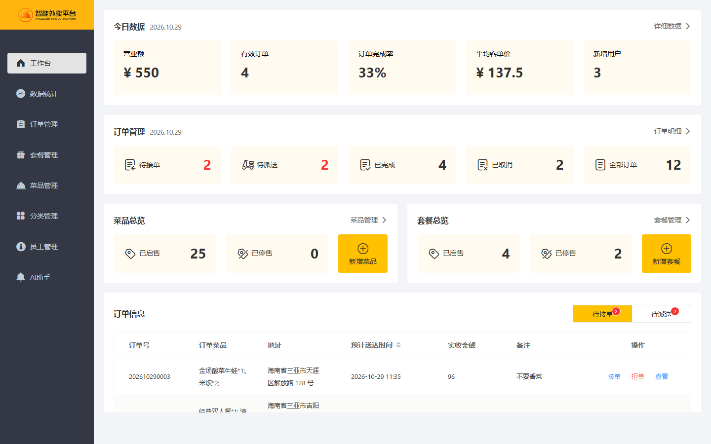
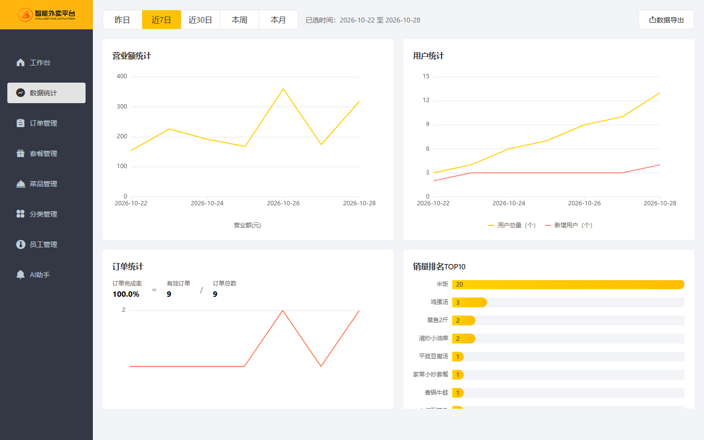
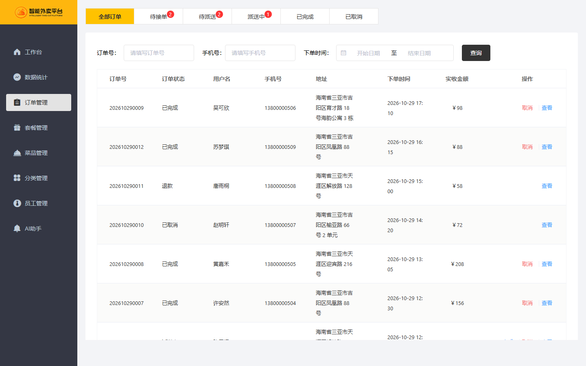
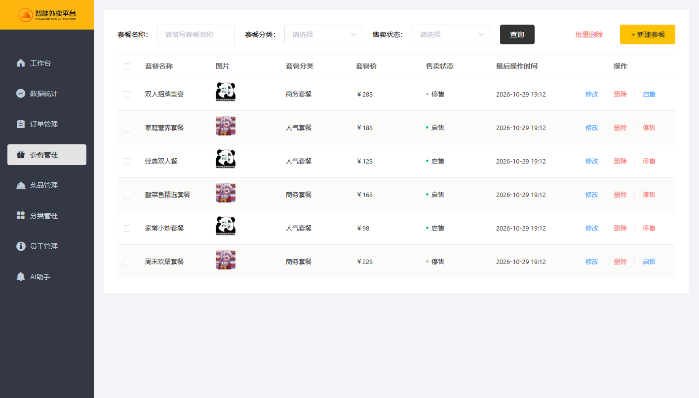
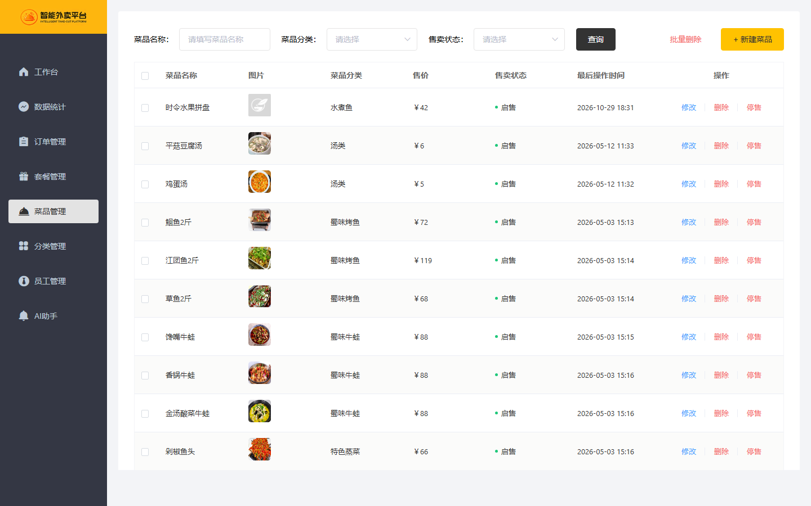
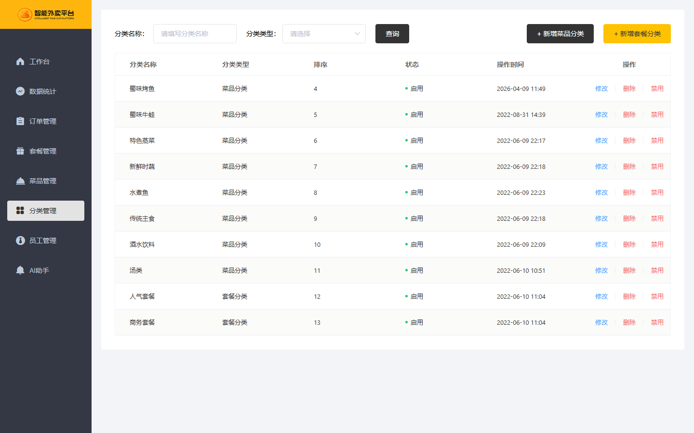
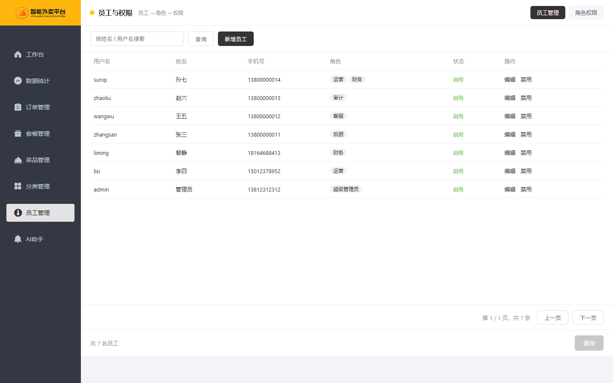
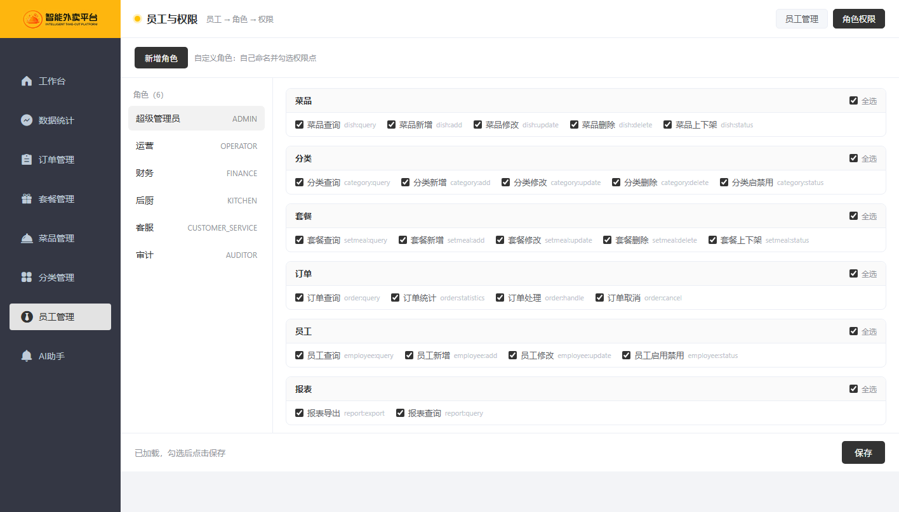
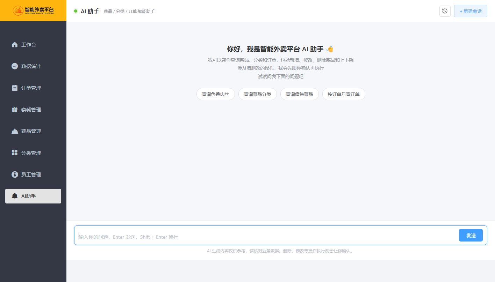

# 智能外卖平台（历史版本归档）

这是「智能外卖平台」的前后端历史归档仓库，包含管理端、后端服务和基于 LangChain4j + 通义千问的 AI 助手。

> 本仓库用于保留课程学习和项目演进中的旧版本，不代表当前正式项目。当前校园食堂预约项目「海韵食刻」位于 [haiyun-campus-meal](https://github.com/tlei49377-afk/haiyun-campus-meal)。

## 页面预览

<details>
<summary><strong>展开查看全部页面截图（每行两张）</strong></summary>

<table>
  <tr>
    <td width="50%" align="center"><strong>管理端登录</strong><br></td>
    <td width="50%" align="center"><strong>工作台</strong><br></td>
  </tr>
  <tr>
    <td width="50%" align="center"><strong>数据统计</strong><br></td>
    <td width="50%" align="center"><strong>订单管理</strong><br></td>
  </tr>
  <tr>
    <td width="50%" align="center"><strong>套餐管理</strong><br></td>
    <td width="50%" align="center"><strong>菜品管理</strong><br></td>
  </tr>
  <tr>
    <td width="50%" align="center"><strong>分类管理</strong><br></td>
    <td width="50%" align="center"><strong>员工管理</strong><br></td>
  </tr>
  <tr>
    <td width="50%" align="center"><strong>角色权限</strong><br></td>
    <td width="50%" align="center"><strong>AI 助手</strong><br></td>
  </tr>
</table>

</details>

## 项目概览

- 管理端：员工与权限、分类、菜品、套餐、订单、统计、报表和店铺状态
- 实时能力：WebSocket 来单提醒、语音提示
- AI 助手：按真实业务数据查询菜品、分类和订单，并执行受控的菜品写操作
- 后端：Spring Boot 3 + MyBatis + MySQL + Redis
- 前端：Vue 2 + Element UI 编译产物，由 Nginx 托管
- 部署：`backend/` 与 `frontend/` 并列，提供可直接使用的 Nginx 代理配置

原版本的微信小程序用户端不在本仓库内。微信登录、微信支付、阿里云 OSS、百度地图和 AI 服务需要真实配置；没有对应配置时，其他后台页面仍可打开，但相关功能不可用。

## 仓库结构

```text
sky-take-out-frontend/
├── backend/                   后端 Maven 多模块工程
│   ├── db/
│   │   ├── sky_take_out.sql   完整数据库初始化脚本
│   │   └── demo_data.sql      可重复导入的演示数据
│   ├── sky-common/            公共模块
│   ├── sky-pojo/              Entity、DTO、VO
│   ├── sky-server/            Controller、Service、Mapper、Task
│   ├── pom.xml
│   └── README.md              后端实现细节
├── frontend/                  管理端静态前端
│   ├── index.html             管理端入口
│   ├── ai-chat.html           AI 助手
│   ├── employee.html          员工与权限
│   └── rbac.html              角色权限
├── conf/
│   ├── nginx.conf             静态托管、接口代理和 WebSocket 配置
│   └── mime.types             静态资源 MIME 类型
├── docs/screenshots/          README 页面截图
└── README.md
```

## 技术栈

| 层次 | 技术 |
|---|---|
| 后端 | Java 17、Spring Boot 3.5、MyBatis、PageHelper、Druid |
| 数据库与缓存 | MySQL 8、Redis |
| 鉴权与文档 | JWT、权限注解 + AOP、Knife4j / OpenAPI 3 |
| 实时与报表 | WebSocket、Apache POI |
| AI | LangChain4j、通义千问 DashScope |
| 前端 | Vue 2 + Element UI 编译产物、Nginx |
| 外部服务 | 阿里云 OSS、微信支付、百度地图 |

## 环境要求

| 组件 | 建议版本 | 用途 |
|---|---|---|
| JDK | 17 或 21 | 运行后端 |
| Maven | 3.8+ | 构建后端 |
| MySQL | 8.0+ | 业务数据 |
| Redis | 6.0+ | 登录会话、缓存和 AI 会话 |
| Nginx | 1.20+ | 托管前端并反向代理接口 |
| 通义千问 API Key | 启动必需 | AI 助手；LangChain4j 自动配置读取该变量 |

## 本地部署

以下步骤以 Windows PowerShell 为例。Linux/macOS 只需把复制文件等 PowerShell 命令替换为对应 shell 命令。

### 1. 克隆仓库

```powershell
git clone -b main https://github.com/tlei49377-afk/sky-take-out-frontend.git
cd sky-take-out-frontend
```

### 2. 启动 MySQL 和 Redis

确保本机 MySQL 和 Redis 已启动。默认配置使用：

- MySQL：`localhost:3306`
- Redis 业务缓存：`localhost:6379`
- AI 社区版 Redis：`localhost:6380`

这些端口都可以在配置文件中修改。若本机只有一个 Redis 实例，可把 AI 社区版 Redis 的 `port` 改为 `6379`。

### 3. 初始化数据库

```powershell
mysql -u root -p -e "CREATE DATABASE IF NOT EXISTS sky_take_out DEFAULT CHARACTER SET utf8mb4 COLLATE utf8mb4_unicode_ci;"
mysql --default-character-set=utf8mb4 -u root -p sky_take_out -e "source backend/db/sky_take_out.sql"
```

也可以使用 MySQL Workbench：新建 `sky_take_out` 数据库，再导入 `backend/db/sky_take_out.sql`。

推荐继续导入演示数据，用于展示工作台、统计图表、订单、套餐和用户趋势：

```powershell
mysql --default-character-set=utf8mb4 -u root -p sky_take_out -e "source backend/db/demo_data.sql"
```

`demo_data.sql` 只会维护固定的演示 ID 范围，可重复执行，不会清空普通业务数据。

演示数据包含 12 位顾客、21 笔不同状态的订单、4 个新增套餐，并补充用户趋势、订单统计和销量排行所需数据；原有 25 道菜、10 个分类和 7 名员工继续保留。

### 4. 创建后端本地配置

```powershell
Copy-Item backend/sky-server/src/main/resources/application-dev.yml.example `
  backend/sky-server/src/main/resources/application-dev.yml
```

打开 `backend/sky-server/src/main/resources/application-dev.yml`，至少修改：

- MySQL 主机、端口、数据库名、用户名和密码
- Redis 主机、端口、密码和 database
- 管理端与用户端 JWT 密钥，使用两段不同的随机字符串
- 需要图片上传时填写阿里云 OSS
- 需要微信登录、支付时填写微信参数
- 需要地址距离校验时填写百度地图 AK

`application-dev.yml` 已被 `.gitignore` 忽略，不要提交真实配置。

业务缓存使用 `sky.redis.*`。AI 社区版 Redis 位于 `backend/sky-server/src/main/resources/application.yml` 的 `langchain4j.community.redis.*`，默认端口与业务 Redis 不同。

### 5. 设置 AI Key

PowerShell：

```powershell
${env:QW-API-KEY} = "你的 DashScope API Key"
```

CMD：

```bat
set "QW-API-KEY=你的 DashScope API Key"
```

IDEA：在 `Run/Debug Configurations` 的 `Environment variables` 中加入：

```text
QW-API-KEY=你的 DashScope API Key
```

### 6. 构建并启动后端

```powershell
cd backend
mvn clean package -DskipTests
java -jar sky-server/target/sky-server-1.0-SNAPSHOT.jar
```

启动后可访问：

- 后端：`http://localhost:8080`
- 接口文档：`http://localhost:8080/doc.html`
- 健康检查：`http://localhost:8080/actuator/health`

如果健康检查提示 MySQL 或 Redis 不可用，请先修复对应配置。

### 7. 安装并启动 Nginx

先确认本机已安装 Nginx：

```powershell
nginx -v
```

如果命令不存在，请从 [Nginx 官网](https://nginx.org/en/download.html) 下载 Windows 版本，并把解压目录加入 `PATH`。

回到仓库根目录执行：

```powershell
$root = (Get-Location).Path
nginx -p "$root/" -c conf/nginx.conf
```

该命令以仓库根目录作为 Nginx prefix，因此 `frontend/`、`conf/nginx.conf` 和 `conf/mime.types` 都能被正确定位。

浏览器访问：

- 管理端：`http://localhost`
- AI 助手：`http://localhost/ai-chat.html`
- 员工与权限：`http://localhost/employee.html`

默认管理员账号来自数据库脚本：

- 用户名：`admin`
- 密码：`123456`

修改 Nginx 配置后重载：

```powershell
nginx -s reload
```

停止 Nginx：

```powershell
nginx -s stop
```

如果 80 端口被占用，把 `conf/nginx.conf` 中的 `listen 80;` 改成其他端口，例如 `listen 8081;`。

### 8. 只预览前端页面

如果暂时不启动后端，可以使用任意静态服务器打开页面，但登录和接口请求不会成功：

```powershell
python -m http.server 4173 --directory frontend
```

访问 `http://localhost:4173`。

## 接口代理关系

```text
浏览器
  ├── /            -> Nginx 返回 frontend/ 静态页面
  ├── /api/*       -> 后端 http://localhost:8080/admin/*
  ├── /user/*      -> 后端 http://localhost:8080/user/*
  └── /ws/*        -> 后端 WebSocket
```

如果后端不在 `localhost:8080`，修改 `conf/nginx.conf` 中的 `proxy_pass` 地址。

## 常见问题

### 后端启动时报 `Could not resolve placeholder 'QW-API-KEY'`

没有设置通义千问 API Key。按“设置 AI Key”步骤配置后重新启动。

### 登录后立即返回登录页或提示 401

检查 Redis 是否启动、密码和 database 是否正确，以及后端日志是否有连接异常。

### 页面能打开但接口报 502

检查后端是否运行在 `8080`，以及 Nginx 的 `proxy_pass` 地址是否正确。

### 图片上传失败

检查阿里云 OSS 的 endpoint、AccessKey、Bucket 和跨域配置。没有 OSS 配置不影响页面打开，但上传功能不可用。

### 微信支付或登录不可用

归档配置只提供占位符。微信登录、支付和回调需要真实 AppID、商户号、API v3 Key、证书以及微信可访问的回调地址。

### 修改前端后页面没有变化

`frontend/` 是编译产物。修改后需要重载 Nginx，并在浏览器中强制刷新。若需要维护前端源码，应回到原前端工程，不建议直接修改压缩后的 JS。

## 安全说明

- 不要把 `application-dev.yml`、`.env`、私钥、证书或真实 API Key 提交到 Git。
- 如果密钥曾经出现在公开提交、截图或历史仓库中，应立即在对应平台轮换并作废旧密钥。
- 本归档只用于学习和演示。部署到公网前应更换默认密码、JWT 密钥，并限制 Actuator 和接口文档访问范围。
- 第三方支付、短信、地图、OSS 和 AI 服务可能产生真实费用，请设置配额和告警。

## 与当前项目的关系

本仓库是旧「智能外卖平台」的技术归档；当前「海韵食刻」是校园食堂预约取餐系统，使用新的前后端代码和业务模型：

- 当前项目：[haiyun-campus-meal](https://github.com/tlei49377-afk/haiyun-campus-meal)
- 本归档：保留旧平台前后端、截图和部署说明，便于回顾技术演进
